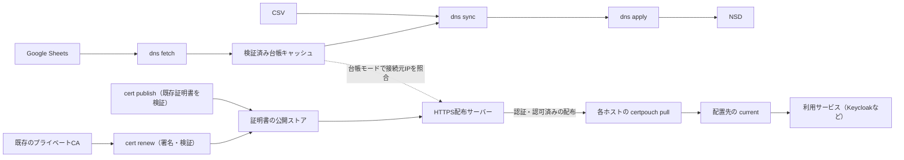

# 対象範囲・アーキテクチャ

## 要件

CertPouchはGo製の単一バイナリとして、セルフホストのDNS・プライベートPKI管理とHTTPSによるPull型証明書配布を提供する。MITライセンスとし、必須のクラウド依存を設けない。外部ACMEプロバイダーに依存せず、完全なACMEクライアントは実装しない。

| 段階 | 対象 | 完了の目安 |
| --- | --- | --- |
| Phase 1 | HTTPS配布、認証・IP制限、メタデータ、Pull、安全な配置、systemd timer例 | まずKeycloak 1ホストで検証可能な配布経路 |
| Phase 2 | Google Sheets、正引き・逆引き、NSD検証・適用、serial | 既存Python出力と比較して説明できる |
| Phase 3 | 既存CAによる発行、更新、世代管理、安全な公開 | 検証済み証明書だけを配布可能 |
| Phase 4 | 監視改善、mTLS、失効運用整備、文書、セキュリティレビュー、リリース自動化 | 本番運用に必要な検証を完了 |

Phase 1でもクライアント資格情報を無効化できなければならない。Phase 4の失効対応は、その運用・機能の拡充として扱う。

既存環境にはPython、Google Sheets、NSD、OpenSSL、中間CA、中央保管された証明書と秘密鍵がある。Phase 1の配布では既存のゾーン生成処理が出力するGoogle Sheetsのスナップショットを接続元の認可に使える。[DNS台帳による接続元制御](../dns-inventory.md)を参照。本番インフラを変更せず、内部情報や資格情報をコミットしない。

## 全体構成

DNS台帳はゾーン生成に使い、台帳モードでは配布時の接続元認可にも使う。既存CAで署名した証明書は検証後に公開ストアへ保存し、各ホストがHTTPSで取得する。

## パッケージ責務

原仕様の構造に従い、実装が必要になった段階で追加する。

| パス | 責務 |
| --- | --- |
| `cmd/certpouch` | 起動、終了コード |
| `internal/cli` | 引数、各ユースケース呼び出し、表示 |
| `internal/config` | YAML読み込み、厳密な検証 |
| `internal/server` | HTTPS起動、停止、ルーティング |
| `internal/distribution` | 配布契約、認証・認可 |
| `internal/client` | 通信、在庫取得、同期制御 |
| `internal/pki` | 証明書検証、後続の発行処理 |
| `internal/storage` | 不変世代、公開対象の切り替え |
| `internal/deployment` | ローカル配置、systemd操作、復旧 |
| `internal/dns` | 在庫アダプター、ゾーン生成・適用 |
| `configs`、`docs`、`tests`、`assets` | 設定例、運用文書、結合試験、ブランド資産 |

標準ライブラリを優先する。必要性なしにDB、Kubernetes、メッセージブローカー、外部オーケストレーターを追加しない。小さなパッケージ、contextによる中断、SIGTERM/SIGINTでの正常終了を基本とする。可変グローバル状態と不要なgoroutineを避ける。

## CLI契約

| コマンド | 要件 | 段階 |
| --- | --- | --- |
| `init server\|client --help` | サーバー・クライアントの初期設定を新規ディレクトリに生成 | 1 |
| `server --config PATH` | 設定・保存領域を検証してHTTPS配布を開始 | 1 |
| `pull --config PATH` | 認証、差分取得、検証、配置、reload、失敗時復旧 | 1 |
| `pull --dry-run --config PATH` | 更新予定を表示 | 1 |
| `status --config PATH` | 証明書、SAN、発行者、期限、fingerprint、最終同期、配置状態を表示 | 1 |
| `dns fetch --config PATH` | Sheetsから台帳を取得・検証し、キャッシュを更新 | 2 |
| `dns sync --config PATH` | 在庫からゾーンを生成し、プレビューまたは検証済み候補を出力 | 2 |
| `dns apply --candidate PATH --zone-dir PATH` | 検証済み候補をNSDに適用し、配信されたserialを確認 | 2 |
| `cert renew --config PATH` | 更新対象の発行・検証・公開 | 3 |

### 詳細化案

- `--config`は必須とし、暗黙の複数パス探索を行わない。
- 未実装の後続コマンドは「未対応」として非ゼロ終了し、成功したように見せない。
- 正常終了は0、実行失敗は1、引数・設定不正は2とする。更新不要は0とする。
- `status`はローカルのみを参照する。破損・欠落した配置は非ゼロ終了とする。
- `--dry-run`は認証・メタデータ比較まで行い、秘密鍵のダウンロード、ファイル更新、サービス操作、同期時刻更新をしない。実配置の成功は保証しない。
- Pullは設定に列挙した証明書だけを対象とし、サーバー側の割り当てだけでは新規配置先を作らない。
- 同じサービスへの複数証明書更新も、Phase 1では証明書単位の処理とする。全証明書をまとめたトランザクションは保証しない。
- 同時Pullはローカル排他で防ぎ、ロック取得失敗は非ゼロ終了する。
- 終了要求後は新規操作を開始せず、安全な処理境界で終了する。切り替え後の復旧責務は[配置仕様](04-certificate-deployment.md)に従う。

## 非対象・未決

自動ルートCA生成、CA秘密鍵のクライアント配布、サーバー応答からの任意コマンド実行は認めない。

Goの最低バージョン、module path、YAMLライブラリは `go.mod` を参照する。サービス配置はLinux/systemdを対象とする。正式な対応Linuxディストリビューションは未決。
