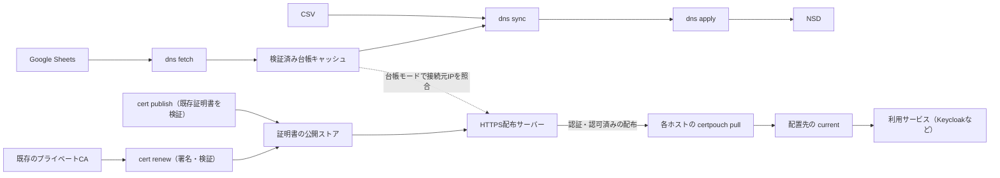

# 対象範囲・アーキテクチャ

## 対象範囲

CertPouchはGo製の単一バイナリで、次を提供する。

- セルフホストのDNS管理（NSD向けの候補生成・検証・適用）
- 既存のプライベートCAを使う証明書の発行・更新
- HTTPSによるPull型の証明書配布と、Linux・systemdでの配置

ライセンスはMITとする。必須のクラウド依存を設けない。外部ACMEプロバイダーに依存せず、完全なACMEクライアントは実装しない。

リリースアーカイブのLinux用インストーラーは、実行ファイルと管理情報だけを配置する。アンインストーラーは管理情報と一致する実行ファイルだけを削除し、設定、資格情報、証明書、状態、systemd unit、サービスアカウントを保持する。[Linuxへのインストールと削除](../linux-installation.md)

操作例は[QuickStart](../quickstart.md)と[手動配布の手順](../manual-distribution.md)を参照する。

## 全体構成

- DNS台帳はゾーン生成に使う。台帳モードでは配布時の接続元認可にも使う。
- 既存CAで署名した証明書は、検証後に公開ストアへ保存する。
- 各ホストは公開ストアの証明書をHTTPSで取得する。

## パッケージ責務

| パス | 責務 |
| --- | --- |
| `cmd/certpouch` | CLI引数、各ユースケース呼び出し、出力と終了コード |
| `internal/config` | YAML読み込み、厳密な検証 |
| `internal/server` | HTTPS起動、停止、ルーティング |
| `internal/distribution` | 配布契約、認証・認可 |
| `internal/client` | 通信、在庫取得、同期制御 |
| `internal/pki` | 証明書検証、発行・更新判定 |
| `internal/storage` | 不変世代、公開対象の切り替え |
| `internal/deployment` | ローカル配置、systemd操作、復旧 |
| `internal/dns` | 在庫アダプター、ゾーン生成・適用 |
| `internal/sheets` | Google Sheets APIとサービスアカウント認証による台帳取得 |
| `internal/update` | GitHub Releaseの確認、配布アーカイブの検証、Linux単体バイナリの切り替え |
| `configs`、`docs`、`assets` | 設定例・systemdユニット例、文書、ブランド資産 |

設計方針:

- 標準ライブラリを優先する。
- 必要性なしにDB、Kubernetes、メッセージブローカー、外部オーケストレーターを追加しない。
- 小さなパッケージ、contextによる中断、SIGTERM/SIGINTでの正常終了を基本とする。
- 可変グローバル状態と不要なgoroutineを避ける。

## CLI契約

### 初期設定と更新

| コマンド | 動作 |
| --- | --- |
| `configure dns` | フラグまたは対話入力から、DNS設定と任意のSheets取得設定を新規ディレクトリへ生成 |
| `configure server` / `configure client` | サーバー・クライアントの初期設定を新規ディレクトリに生成 |
| `update [--check]` | GitHubの安定版Releaseを確認し、Linuxの単体バイナリを検証後に更新。`--check` は版の比較だけを行う |

### 配布と配置

| コマンド | 動作 |
| --- | --- |
| `server --config PATH` | 設定・保存領域を検証してHTTPS配布を開始 |
| `server --check-config --config PATH` | 待ち受けせずに設定・TLS鍵ペア・公開ストアを確認 |
| `pull --config PATH` | 認証、差分取得、検証、配置、reload、失敗時復旧 |
| `pull --dry-run --config PATH` | 更新予定を表示 |
| `status --config PATH` | 証明書、SAN、発行者、期限、fingerprint、最終同期、配置状態を表示 |

### 証明書

| コマンド | 動作 |
| --- | --- |
| `cert publish --config PATH` | 発行済み証明書と秘密鍵を検証して公開 |
| `cert renew --config PATH` | `server.yaml` の更新設定を使い、対象証明書を発行・検証・公開 |
| `cert status --config PATH` | 公開ストアの証明書の期限と状態を確認 |

### DNSと同期

| コマンド | 動作 |
| --- | --- |
| `dns fetch --config PATH` | Sheetsから台帳を取得・検証し、キャッシュを更新 |
| `dns fetch --status --config PATH` | キャッシュと最終成功時刻をオフラインで確認 |
| `dns sync --config PATH` | 在庫からゾーンを生成し、プレビューまたは検証済み候補を出力 |
| `dns diff --candidate PATH` | `--zone-dir` の現行、または `--baseline` の候補と比較 |
| `dns apply --candidate PATH --zone-dir PATH` | 検証済み候補をNSDに適用し、配信されたserialを確認 |
| `pipeline --config PATH` | Sheets取得から検証済みDNS候補の生成までを実行。`--apply PATH` を明示すると候補をNSDへ反映 |
| `pipeline --check --config PATH` | ローカルのSheets取得設定、ディレクトリ、NSD設定・コマンドを確認 |
| `pipeline --once` / `pipeline --watch` | Sheets取得、NSD反映、台帳確定、証明書更新を実行。前者は1回、後者は定期実行 |

### 実行時の動作

**引数と終了コード**

- YAMLを読むコマンドには `--config PATH` を指定する。暗黙のパス探索は行わない。
- 成功は0、処理失敗は1、引数の不正は2を返す。設定エラーの終了コードはコマンドによって1または2。
- `--help`、`-h`、`certpouch help [command]` で要求されたヘルプは標準出力に出し、0を返す。
- コマンドの不足・不明や引数の不正で表示する使い方は標準エラーに出し、2を返す。

**Pullとstatus**

- `status` はローカルだけを参照する。破損・欠落した配置は非ゼロ終了とする。
- `pull --dry-run` は認証とメタデータ比較を行う。秘密鍵のダウンロード、ファイル更新、サービス操作、同期時刻更新はしない。実配置の成功は保証しない。
- Pullは設定に列挙した証明書だけを対象とする。サーバー側の割り当てだけでは新規配置先を作らない。
- 同じサービスへの複数証明書の更新も、証明書単位で処理する。全証明書をまとめたトランザクションは保証しない。
- 同時Pullはローカル排他で防ぐ。ロックを取得できなければ非ゼロ終了する。
- 終了要求後は新規操作を開始せず、安全な処理境界で終了する。切り替え後の復旧責務は[配置仕様](04-certificate-deployment.md)に従う。

## 対応範囲

次の動作は認めない。

- ルートCAの自動生成
- CA秘密鍵のクライアント配布
- サーバー応答に基づく任意コマンドの実行

Goの最低バージョン、module path、YAMLライブラリは `go.mod` を参照する。サービス配置はLinux/systemdを対象とする。隔離環境での検証範囲は[検証・運用](06-verification-operations.md)を参照する。
