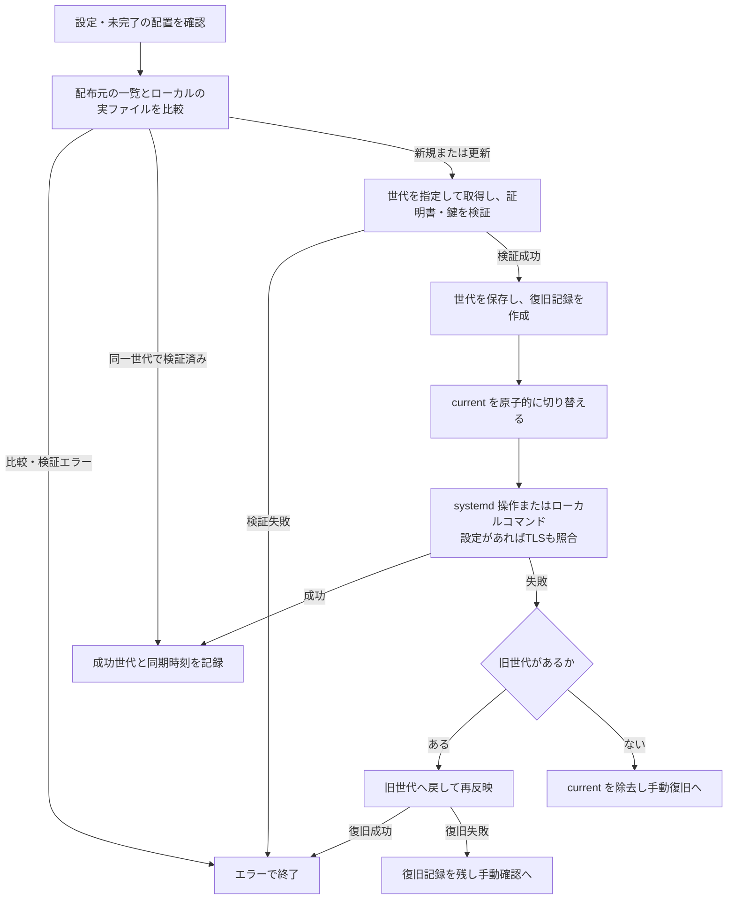

# 証明書保存・検証・配置仕様

## 要件

**検証**

- 公開前と配置前に、PEM、鍵一致、有効期間、期待SAN、期待発行者、チェーン、Server Authentication EKUを検証する。
- Goの `crypto/x509`、`crypto/rsa`、`crypto/tls` を使用する。
- 既存CAを信頼設定として扱い、新しいルートCAを自動で生成しない。

**Pull**

- Pullは冪等とし、配置が正常に終わった後だけサービス操作を行う。
- ダウンロード、チェックサム検証、所有者・権限設定、アクティブ世代の原子的切り替え、reload確認、失敗時の復旧を行う。
- サーバーから受け取ったコマンドは実行しない。

## 保存モデル

```text
<certificate_dir>/<name>/
  versions/<version>/
    certificate.pem
    chain.pem
    private-key.pem
  current -> versions/<version>
```

**世代と切り替え**

- versionは、ランダム128ビットを小文字16進32桁で表した不透明なIDとする。一度公開した世代の内容は変更しない。
- 全成果物を同じファイルシステムの一時ディレクトリに書き、検証・fsyncの後で世代として確定し、`current` をrenameで切り替える。
- 公開処理は証明書単位で排他する。読み手は固定した世代からだけ読む。
- 世代を自動削除しない。運用で削除する場合も、`current` と復旧に必要な直前の世代を残す。

**公開と読み込み**

- `cert publish` と `cert renew` は、検証済みの証明書をこの形式で登録する。
- メタデータは、配布在庫を組み立てるときに生成する。
- 配布サーバーは起動時に公開世代を読み込み、再検証する。定期読み込みを設定した場合は、全体の検証に通った在庫へ一括で切り替える。[登録と反映の手順](../server-publication.md)

**保護**

- サーバーの保存領域は所有者だけがアクセスできるようにし、配布する秘密鍵は0600とする。CA署名鍵は保存対象に含めない。
- 不明なsymlink、保存ルート外への参照、通常ファイル以外の成果物を拒否する。管理下の世代を指すsymlinkは `current` だけであることを検証する。

## 検証ポリシー

| 対象 | 判定 |
| --- | --- |
| PEM | 想定したブロック種別・個数を満たす。余分な秘密鍵や、空でない未知のデータを拒否 |
| 秘密鍵 | RSA PKCS#1/PKCS#8の非暗号化PEM、2048ビット以上 |
| 鍵一致 | 証明書の公開鍵と秘密鍵の公開部が一致 |
| リーフ | CA証明書ではないこと。RSAのサーバー証明書を対象とする |
| 時刻 | UTC現在時刻で NotBefore ≤ now < NotAfter。猶予による期限切れの許容なし |
| SAN | 設定したDNS/IP SAN集合と一致。重複・順序は無視し、DNSは大文字小文字と末尾ドットを正規化 |
| ホスト名 | CNへのフォールバックをしない。IPはIP SANで検証 |
| 発行者 | ローカルで指定した発行者証明書で署名を検証。Issuer DNだけで信頼しない |
| チェーン | 明示した信頼アンカーと配布された中間証明書から `x509.Verify` を実行 |
| EKU | ServerAuthを明示的に含むこと。EKUの欠落を暗黙に許可しない |

- ワイルドカードと、設定にないSANは拒否する。
- 証明書のCRL・OCSPは参照しない。配布クライアントの失効は[失効手順](../client-revocation.md)を参照する。

## 変更検出

- リーフDERのSHA-256をfingerprintとする。
- チェーンだけの更新も検知するため、fingerprintに加えてversionと各artifactのハッシュを比較する。
- ローカルの状態ファイルだけで「更新不要」と判定せず、`current` の実ファイルを検証する。
- 同じ世代で全ハッシュが一致し、検証も正常なら、ファイルの切り替えとreloadを省略する。
- 壊れたファイル、権限の不一致、未完了の状態は、正常な同期として扱わない。

## Pull状態遷移



| 状態 | 処理 | 失敗時 |
| --- | --- | --- |
| 準備 | 設定、排他、前回の未完了状態の確認 | 現行世代に触れず終了 |
| 比較 | 認証、一覧・metadata取得、ローカル比較 | 設定した対象が一覧にない場合も非ゼロ終了 |
| 取得 | 固定したversionを一時領域へダウンロード | `current` を維持して終了 |
| 検証 | ハッシュ、PEM、鍵、SAN、発行者、チェーン、期限 | `current` を変更しない |
| 準備完了 | 所有者・権限設定、世代確定、旧世代と操作状態の永続化 | `current` を変更しない |
| 切り替え | 一時symlinkを作り `current` へrename | 旧 `current` を保持して終了 |
| 反映 | 設定したsystemd操作またはローカルコマンド、設定時のTLS照合 | 復旧へ進む |
| 完了 | 成功世代・同期時刻・状態の永続化 | 状態保存の失敗も非ゼロ終了とし、要確認とする |
| 復旧 | 旧 `current` へ切り戻し、旧構成を再反映・確認 | 復旧失敗を明示し、非ゼロ終了 |

### 配置先の形式

- 配置先もサーバーと同じ `versions`・`current` 形式を使う。
- サービスは `current/certificate.pem` と `current/private-key.pem` を参照する。必要な場合は、リーフと中間を連結した `fullchain.pem` をローカルで生成する。
- 一時領域と確定世代は同じファイルシステムに置く。ファイルと親ディレクトリを同期し、電源断時の保証を確認する。
- 原子的なポインター切り替えだけでは、サービスが別々のタイミングで開く複数ファイルが同じ世代である保証にはならない。更新中のサービスの起動・reloadを運用上で直列化し、初回のKeycloak試験で参照方法を確認することを導入条件とする。

### 反映と確認

| 方式 | 成功の条件 |
| --- | --- |
| `service` | 30秒以内に、systemdの操作と `is-active` が成功する |
| `command` | シェル展開せずに指定の引数配列で実行し、タイムアウト内に終了コード0で終わる |

- どちらの方式も、切り戻し時に同じ操作を繰り返す。
- `service.verify_tls` または `command.verify_tls` を指定した場合は、操作の後に直接TLS接続し、信頼CA・サーバー名と、アクティブ世代のリーフのSHA-256を照合する。
- TLS照合全体の上限は既定15秒で、1秒から2分を指定できる。上限内に一致しなければ反映失敗とし、旧世代の再反映にも同じ確認を適用する。[設定例](../client-deployment.md)

### 失敗と復旧

- 初回配置で旧世代がない場合、反映に失敗すると `current` を除去し、失敗した世代を有効扱いにしない。元のサービス設定の復元は事前の移行手順に従い、完全な自動復旧は保証しない。
- `current` の切り替え前後の状態をローカルのジャーナルに記録する。
- 次回起動時に未完了を検出し、旧世代があれば復旧して確認する。
- 旧世代がない場合や状態が破損している場合は、自動更新を停止して手動確認を求める。
- 切り戻しが成功すると復旧記録を削除する。手動確認が必要な場合は復旧記録を保持する。

### 複数の証明書

- 名前順に証明書単位で実行し、1件の失敗で残りを止めない。
- 次の失敗は、その証明書だけの失敗として標準エラーに名前付きで報告する。
  - サーバーの在庫にない名前
  - ローカル検証の失敗
  - ダウンロード、配置、反映の失敗
  - 異常終了後の復旧の失敗
- `--dry-run` 以外で、配置先のロックを取得した後に失敗した場合は、その証明書の `last_error_category` も記録する。
- 成功した証明書の行は標準出力に出す。
- 1件でも失敗すれば、最後に失敗件数を表示して終了コード1を返す。`--dry-run` も同じくすべてを評価する。
- 在庫の取得自体に失敗した場合と、SIGTERM・SIGINTで中断した場合は、残りを処理しない。
- 同期成功時刻は証明書単位で保持する。
