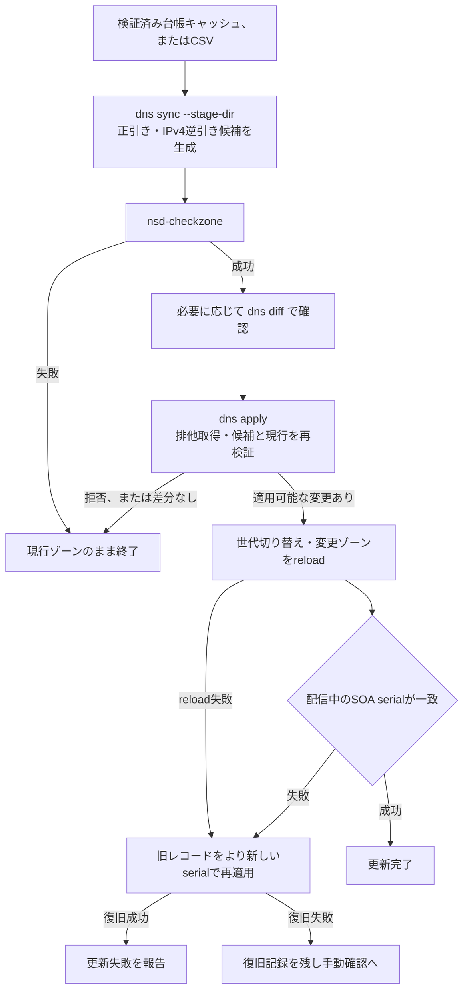

# DNS・Private PKI仕様

この文書は、DNS台帳の取得、NSD候補の生成と適用、既存CAによる証明書の発行・更新を定める。

## DNS機能の概要

| 段階 | コマンド | 動作 |
| --- | --- | --- |
| 台帳の取得 | `dns fetch` | 読み取り専用のサービスアカウントで台帳を取得し、検証に成功した場合だけキャッシュを更新する。[Sheetsの取得設定](../sheets-fetch.md) |
| 候補の生成 | `dns sync --stage-dir` | 既存のスナップショットまたはCSVから正引き・IPv4逆引きを生成し、`nsd-checkzone` 済みの候補を保存する |
| 差分の確認 | `dns diff` | 候補と現行、または候補同士の差分とserialを表示する |
| 適用 | `dns apply` | 管理下のスナップショットを切り替え、実際に配信されたserialを確認する。失敗時は旧レコードを新しいserialで切り戻す |
| まとめて実行 | `pipeline` | 台帳キャッシュを取得して検証済み候補を生成する。候補の生成に失敗しても取得済みキャッシュは残る。`--apply CANDIDATE` で、初期登録済みのNSD管理世代へ候補を適用する |

- 在庫の取得とゾーンの生成は、独立したコマンドで実行できる。
- 証明書の発行は、同じ設定を使う `cert renew` で行う。
- 配布認可でもGoogle Sheetsのスナップショットを参照できる。[配布認可に使う台帳の列と設定](../dns-inventory.md)
- 手順は[DNS候補の設定と適用](../dns-sync.md)を参照する。

### 運用上の要件

- 既存Python実装の出力と比較してから切り替える。
- 本番のspreadsheet ID、内部DNSレコード、資格情報を公開リポジトリへ保存しない。

## 台帳とレコード生成

| 項目 | 意味 |
| --- | --- |
| zone | 管理対象ゾーンのFQDN |
| owner | レコードの所有者。ゾーン外への意図しない生成を拒否 |
| type | 明示的にサポートしたRR型 |
| ttl | ゾーンに適用する正の整数秒 |
| value | RR型ごとに検証する値 |

**生成するレコード**

- 列の解釈は[DNS台帳の列規則](../dns-inventory.md)に従う。
- 台帳のIPv4アドレスから、AとIPv4 PTRを生成する。IPv6逆引きは生成しない。
- ゾーン設定から、SOAとNSを生成する。
- `dns.zones.static_records` で台帳外の固定レコードを追加できる。A、AAAA、CNAME、MX、TXT、PTRを指定でき、CNAMEの衝突と循環を検証する。

**逆引きゾーン**

- `dns.zones.reverse_zones` を指定すると、指定したIPv4 /24逆引きゾーンを、PTRが0件でも候補に残す。
- 指定外のゾーンが必要になった場合は、候補の生成に失敗する。
- NSDへのゾーン登録は別途行う。

**失敗と安定性**

- Sheetsの取得・検証に失敗した場合は、キャッシュを置き換えない。
- 空の台帳はゾーン生成エラーとなる。
- 出力順は安定させる。serial以外に差分がなければ、適用とreloadを省略する。

## serial管理

serialは32ビットの整数として扱い、RFC 1982のserial算術で新旧を判断する。設定で明示するか、既存世代のserialを1ずつ進める。

| 状況 | 使う指定 |
| --- | --- |
| 初回の候補 | `dns sync --serial N` |
| 管理世代を持った後 | `dns sync --serial-from` で管理中の現在世代からSOA serialを取得する |
| NSD登録前に、生成済みの候補を基準に作り直す | `dns sync --serial-from-baseline` で古い候補の各ゾーンのserialを引き継ぐ |

- 適用前に、失敗時の切り戻しに使うserialも旧世代より新しくなることを確認する。
- 適用前に `dns diff` で候補との差分とserialを確認できる。NSD登録前は `dns diff --baseline` で生成済みスナップショット同士を比較できる。

## 適用手順

現行のCLIでは、候補の生成とNSDへの適用を別のコマンドで行う。図はNSDに初期登録した後の更新を示す。

1. `dns sync --stage-dir` は、台帳から正引き・逆引きを生成し、すべての候補を `nsd-checkzone` で検証する。
2. `dns apply` は適用ロックを取得し、候補と現行を比較する。同じゾーン集合であることと、NSDが現行のserialを配信していることを確認する。
3. 候補世代と切り戻し用の世代を再検証して保存し、復旧記録を書いてから `current` を切り替える。
4. 変更したゾーンをreloadし、ループバックTCPのSOA応答で新しいserialを確認する。
5. 適用に失敗した場合は、旧レコードをより新しいserialで再適用する。復旧できない場合は記録を保持し、次回の適用を停止する。

- ファイルの参照先は一度に切り替わる。NSDの複数ゾーンのreloadは順次行うため、配信が同時に切り替わる保証はない。
- `dns apply --max-removed-records` で、削除・置換されるレコード行の合計に上限を設けられる。判定対象は、適用ロックの取得後に読み込んだ現行世代と候補である。SOAとゾーン共通TTLは計数から除く。

## Private PKI

既存のプライベートCAを署名主体として使い、Goの `crypto/x509` で発行する。新しいルートCAは自動生成しない。

- `cert renew` は既存のRSA CAで発行・更新を行う。[設定と運用](../certificate-renewal.md)
- 暗号化PEMは、OpenSSLでメモリ上に復号できる。
- 外部署名器とは連携しない。

| プロファイル項目 | 要件 |
| --- | --- |
| 鍵 | 初期はRSA 2048 |
| SAN | DNS SANとIP SANを設定可能 |
| EKU | Server Authentication |
| 有効期間 | 設定可能 |
| チェーン | 既存の中間CAを含める |
| 公開 | 新世代の全検証後のみ。既存の正常な世代を先に上書きしない |

### 更新フロー

1. 現在の証明書と更新ポリシーを読み込む。
2. 残存期間が更新閾値以下の対象を選ぶ。
3. 新しいRSAリーフ鍵を生成し、既存CAでリーフ証明書を直接発行する。
4. 設定済みの中間証明書を、配布用のチェーンとして組み合わせる。
5. [共通検証](04-certificate-deployment.md)と要求プロファイルで検証する。
6. 公開時に排他を取得し、発行中に現行世代が変わっていないことを確認してから、新しい世代へ原子的に切り替える。
7. 更新結果を表示する。配布在庫に反映された世代は、クライアントが次回のPullで取得する。

### 発行の制約

- 更新閾値とリーフの有効期間は、更新設定で指定する。
- 発行ごとに新しい鍵を使う。
- CA証明書の残存期間を超える有効期間を認めない。CAが期限切れ、または鍵が一致しない場合は発行を中止する。
- 証明書のserialは、暗号学的乱数から正の値を生成する。
- 暗号化されたCA鍵のパスフレーズは専用のファイルディスクリプターでOpenSSLへ渡し、プロセス引数やログへ出力しない。
- 発行プロセスの終了コードだけで成功とせず、成果物を検証する。失敗時は既存の公開世代を維持する。
- CA秘密鍵は発行処理だけが参照できる場所へ隔離し、配布APIから到達させない。
