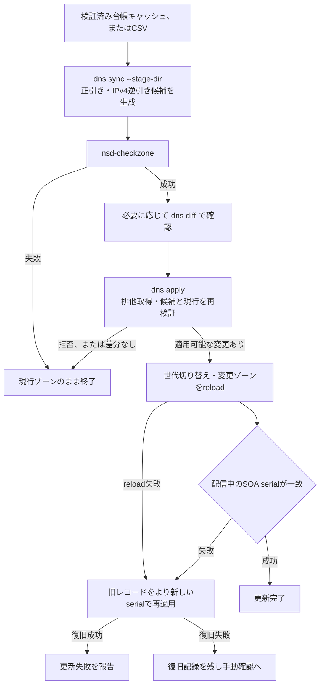

# DNS・Private PKI仕様

この文書はDNS台帳の取得、NSD候補の生成と適用、既存CAによる証明書発行・更新を定義する。

配布認可ではGoogle Sheetsのスナップショットを参照できる。[配布認可に使う台帳の列と設定](../dns-inventory.md)を参照。`dns fetch` は読み取り専用のサービスアカウント認証で台帳を取得し、検証に成功した場合だけキャッシュを更新する。[Sheetsの取得設定](../sheets-fetch.md)

既存スナップショットまたはCSVから正引き・IPv4逆引きを生成する。前回serialが指定された場合は比較またはインクリメントを行う。`dns sync --stage-dir` では `nsd-checkzone` 済みの候補を保存し、`dns apply` では管理下のスナップショットへ切り替える。更新後は実際に配信されたserialを確認し、失敗時は旧レコードを新しいserialで切り戻す。[DNS候補の設定と適用](../dns-sync.md)

`dns sync --serial-from` は管理下の現在世代からSOA serialを取得する。`zones.static_records` で台帳外の固定レコードを追加し、CNAMEの衝突と循環を検証する。適用前に `dns diff` で候補との差分とserialを確認できる。

NSD登録前は、`dns diff --baseline` で生成済みスナップショット同士を比較できる。古い候補に含まれる各ゾーンのserialから更新候補を作る場合は `dns sync --serial-from-baseline` を使う。

通常の適用では、`dns apply --max-removed-records` で削除・置換されるレコード行の合計に上限を指定できる。判定対象は適用ロック取得後に読み込んだ現行世代と候補で、SOAとゾーン共通TTLは計数から除く。

## DNS機能

`pipeline --config PATH` は台帳キャッシュを取得して検証済み候補を生成する。候補生成に失敗した場合も取得済みキャッシュは残る。`pipeline --apply CANDIDATE` は初期登録済みのNSD管理世代へ明示された候補を適用する。発行は同じ設定を使う `cert renew` で行う。

`pipeline.dns.zones.reverse_zones` を指定すると、指定したIPv4 /24逆引きゾーンをPTRが0件でも候補に残す。指定外のゾーンが必要な場合は候補生成に失敗する。NSDへのゾーン登録は別途行う。

- Google SheetsのキャッシュとCSVを読み込む。
- 在庫取得とゾーン生成は独立したコマンドで実行する。
- NSD向けの正引き・逆引きゾーンを生成する。
- serialを管理し、`nsd-checkzone`成功後だけゾーンを原子的に置換してNSDをreloadする。
- 既存Python実装の出力と比較してから切り替える。
- 本番spreadsheet ID、内部DNSレコード、資格情報を公開リポジトリへ保存しない。

### 台帳とレコード生成

| 項目 | 意味 |
| --- | --- |
| zone | 管理対象ゾーンのFQDN |
| owner | レコード所有者。ゾーン外への意図しない生成を拒否 |
| type | 明示的にサポートしたRR型 |
| ttl | ゾーンに適用する正の整数秒 |
| value | RR型ごとに検証する値 |

列の解釈は[DNS台帳の列規則](../dns-inventory.md)に従う。台帳のIPv4アドレスからAとIPv4 PTRを生成する。ゾーン設定からSOA・NSを生成し、固定レコードにはA、AAAA、CNAME、MX、TXT、PTRを指定できる。IPv6逆引きは生成しない。

Sheetsの取得・検証に失敗した場合はキャッシュを置き換えない。空の台帳はゾーン生成エラーとなる。適用時の削除・置換上限は `--max-removed-records` で指定できる。出力順は安定し、serial以外に差分がなければ適用・reloadを省略する。

### 適用手順

現行のCLIでは候補生成とNSDへの適用を別のコマンドで行う。図はNSDに初期登録した後の更新を示す。

1. `dns sync --stage-dir` は台帳から正引き・逆引きを生成し、全候補を `nsd-checkzone` で検証する。
2. `dns apply` は適用ロックを取得し、候補と現行を比較する。同じゾーン集合であることと、NSDが現行serialを配信していることを確認する。
3. 候補世代と切り戻し世代を再検証して保存し、復旧記録を書いてから `current` を切り替える。
4. 変更ゾーンをreloadし、ループバックTCPのSOA応答で新serialを確認する。
5. 適用失敗時は旧レコードをより新しいserialで再適用する。復旧できない場合は記録を保持し、次回の適用を停止する。

ファイルの参照先は一度に切り替わる。NSDの複数ゾーンのreloadは順次行うため、配信が同時に切り替わる保証はない。

serialは32ビットの整数として扱い、RFC 1982のserial算術で新旧を判断する。設定で明示するか、既存世代のserialを1ずつ進める。適用前に、失敗時の切り戻しに使うserialも旧世代より新しくなることを確認する。

## Private PKI

既存のプライベートCAを署名主体として使い、Goの `crypto/x509` で発行する。新ルートCAは自動生成しない。

`cert renew` は既存RSA CAを使う発行・更新を行う。暗号化PEMはOpenSSLでメモリ上に復号できる。外部署名器とは連携しない。[設定と運用](../certificate-renewal.md)

| プロファイル項目 | 要件 |
| --- | --- |
| 鍵 | 初期はRSA 2048 |
| SAN | DNS SANとIP SANを設定可能 |
| EKU | Server Authentication |
| 有効期間 | 設定可能 |
| チェーン | 既存中間CAを含める |
| 公開 | 新世代の全検証後のみ。既存の正常世代を先に上書きしない |

### 更新フロー

1. 現在の証明書と更新ポリシーを読み込む。
2. 残存期間が更新閾値以下の対象を選ぶ。
3. 新しいRSAリーフ鍵を生成し、既存CAでリーフ証明書を直接発行する。
4. 設定済みの中間証明書を配布チェーンとして組み合わせる。
5. [共通検証](04-certificate-deployment.md)と要求プロファイルを検証する。
6. 公開時に排他を取得し、発行中に現行世代が変わっていないことを確認してから、新世代へ原子的に切り替える。
7. 更新結果を表示する。配布在庫に反映された世代をクライアントが次回Pullで取得する。

CA証明書の残存期間を超える有効期間を認めない。CAが期限切れ・鍵不一致の場合は発行を中止する。証明書serialは暗号学的乱数から正の値を生成する。

更新閾値とリーフの有効期間は更新設定で指定する。発行ごとに新しい鍵を使う。暗号化キーのCAパスフレーズは専用ファイルディスクリプターでOpenSSLへ渡し、プロセス引数やログへ出力しない。

発行プロセスの終了コードだけで成功とせず、成果物を検証する。失敗時は既存の公開世代を維持する。CA秘密鍵は発行処理だけが参照できる場所へ隔離し、配布APIから到達させない。
